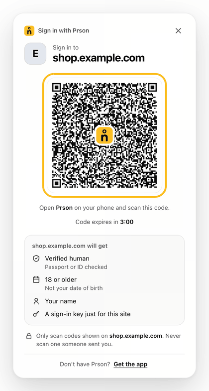
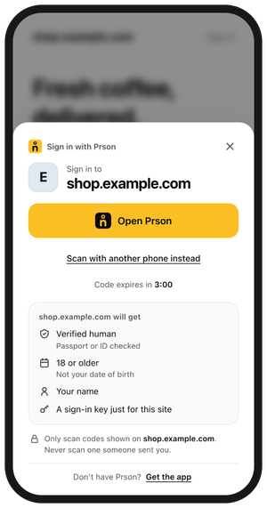
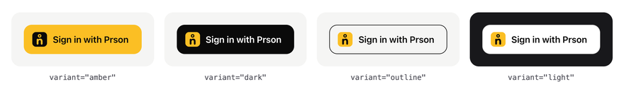

<p align="center">
  
</p>
<h1 align="center">@prson/login-sdk-ui</h1>
<p align="center">The "Sign in with Prson" button and sign-in dialog for <a href="https://www.npmjs.com/package/@prson/login-sdk"><code>@prson/login-sdk</code></a>. Import it once; there's nothing to configure.</p>
<p align="center">
  <a href="https://www.npmjs.com/package/@prson/login-sdk-ui"></a>
  <a href="https://github.com/Yumankind/prson-sdk/blob/main/LICENSE"></a>
  
</p>

<p align="center">
  <picture>
    <source media="(prefers-color-scheme: dark)" srcset="https://raw.githubusercontent.com/Yumankind/prson-sdk/main/docs/media/sign-in-dialog-dark.gif">
    
  </picture>
  &nbsp;&nbsp;
  
</p>

## Install

```bash
npm install @prson/login-sdk @prson/login-sdk-ui
```

```ts
import "@prson/login-sdk-ui";              // registers the dialog and the button
import { PrsonLogin } from "@prson/login-sdk";

document.querySelector("#signin")!.addEventListener("click", () =>
  PrsonLogin.signIn({ nonce: getNonceFromYourServer, required: { minVerificationLevel: 1 } }),
);
```

No build step? Load both bundles from prson.net:

```html
<script type="module" src="https://prson.net/vendor/prson-login/prson-login-ui.js"></script>
<script type="module">
  import { PrsonLogin } from "https://prson.net/vendor/prson-login/prson-login.js";
</script>
```

## The dialog

`signIn()` opens it by itself.

- **On a computer:** a code to scan, with a ring that counts down its 3 minutes.
- **On a phone:** an **Open Prson** button instead of the code.
- **What the site will get:** read from the request, such as "18 or older, not your date of birth".
- **Progress:** each step is shown as it happens: phone connected, checking the proof, signed in.
- **When a code runs out:** **Get a new code** makes a fresh one while `signIn()` keeps waiting.
- **Accessible:** focus stays in the dialog and comes back when it closes, Esc closes it, steps are announced to screen readers, and motion stops when reduced motion is on.

To show the card inside your own page instead, pass `ui: { mountQrInto: "#where" }`.

## The button

<p align="center">
  
</p>

```html
<prson-signin-button id="signin" variant="amber" size="lg"></prson-signin-button>
```

| Attribute | Values |
|---|---|
| `variant` | `amber` (default), `dark`, `outline`, `light` (for dark backgrounds) |
| `size` | `md` (44 px), `lg` (52 px) |
| `full-width`, `busy`, `disabled` | Stretch it, show progress, or disable it |
| `label` | Your own text, such as "Continue with Prson" |

It renders a real `<button>`, so forms, focus and your CSS work as usual. From script: `createSignInButton({ variant, size, onClick })`.

## Theming

`ui.theme` is `"auto"` (follows the system), `"light"` or `"dark"`. To match your brand, override the CSS variables on `[data-prson-login-ui]`:

```css
[data-prson-login-ui] {
  --prson-amber: #2563eb;
  --prson-radius: 20px;
  --prson-font: "Your Font", system-ui, sans-serif;
}
```

The full list is in [`src/styles.ts`](https://github.com/Yumankind/prson-sdk/blob/main/packages/browser-ui/src/styles.ts). The code itself always stays dark on white, so phones can read it.

**Content-Security-Policy:** the dialog adds a `<style>` element. Put your nonce on `<meta property="csp-nonce" nonce="…">` and it uses it. The other lines your policy needs are in [the main README](https://github.com/Yumankind/prson-sdk/blob/main/README.md#content-security-policy).

## Your own renderer

Importing the package registers its renderer on `window.__prsonLoginQrRenderer`. To wrap it, import `renderQrCard` and set your own function after the import:

```ts
import { renderQrCard } from "@prson/login-sdk-ui";

window.__prsonLoginQrRenderer = (url, mount, theme, context) => {
  // your logic, then:
  return renderQrCard(url, mount, theme, context);
};
```

## Size

About 104 KB, or 26 KB gzipped. Most of it is the QR code library.

## Building

```bash
cd login-sdk/packages/browser-ui
npm install
npm run build           # → dist/index.js
```

`npm run build:vendor` in `login-sdk/` rebuilds every committed bundle, including the copies served from `prson.net/vendor/prson-login/`; CI refuses a deploy if they're stale.
